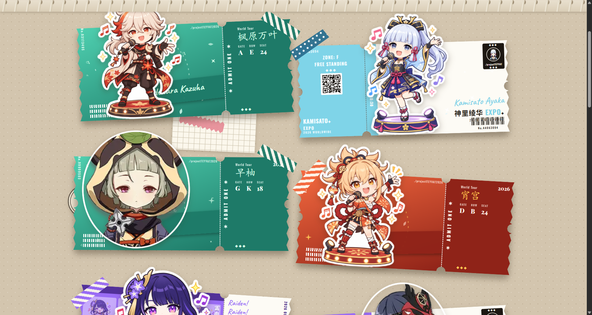

# 提瓦特巡演票墙 · Teyvat Ticket Wall

> [Delusional] Concert Tickets Addendum — 原神全角色，每人一场专属演唱会。

一个致敬 Vocaloid 演唱会门票拼贴画（projectTiGER 风格）的粉丝项目：软木板背景上钉满**原神全角色**的演唱会门票。每张票都是一幅完整的插画——由 AI 按参考图风格整票生图，角色设计以官方图标锚定，票号/日期/排号/座位由角色数据确定性派生。

**在线预览**: https://flower0wine.github.io/genshin-ticket-wall/



## 元素构成 — 什么用代码，什么用生图

参考图的每个视觉元素都有明确的实现归属：

| 元素 | 实现方式 | 位置 |
| --- | --- | --- |
| **整张票面插画**（角色立绘 + 票体 + 撕票线 + 锯齿边 + 票面文字） | **AI 整票生图**（codex `image_generation`，附参考图锁风格 + 官方图标锁角色），白底泛洪转透明 → alpha WebP | `public/tickets/*.webp` |
| 软木板点纹背景 | CSS `radial-gradient` 双层点阵 | `src/styles/wall.css` |
| 顶部螺旋线圈装订 | CSS 渐变 + `repeat-x` | `.spiral` |
| 票下底纸（方格纸/牛皮纸/竖排手写歌词纸条） | CSS 渐变 + `writing-mode` | `BoardScraps.tsx` |
| 散落和纸胶带（条纹/波点/锯齿边） | CSS 渐变 + `clip-path` | `Tape` / `BoardScraps` |
| 独立角色圆章 | CSS 双环 border + 官方头像 | `BoardScraps` |
| 票面投影 / 旋转 / 悬停放大 | CSS `drop-shadow` + `transform` | `TicketCard` |
| 日期 / 排号 / 座位 / 序列号 / 版式 | 由角色数据确定性派生（FNV-1a + mulberry32），喂给生图 prompt 与兜底票面 | `src/data/index.ts` · `scripts/ticket-spec.mjs` |
| **CSS 兜底票面**（无生图时） | 手写 CSS/SVG：锯齿 `clip-path`、条形码、二维码、印章、溢出立绘 | `tickets.tsx` · `ticket-clip.ts` · `decor.tsx` |
| 角色 chibi 立绘 / 头像兜底 | AI 生图（`public/art`）/ 官方图标（`public/icons`）/ 元素配色 SVG 首字母章 | `fallbackIcon` |

**原则**：票面主体（无法用代码表达的角色插画与印刷质感）用**整票生图**，一次出图保证风格统一、文字与图形一体；**拼贴环境（背景、底纸、胶带、圆章、投影、布局）全部代码生成**，可维护、可缩放、零额外图片体积。没有生图的角色自动回退到数据驱动的 CSS 票面，页面永远完整。

## 四种票面版式

对应参考图的四张票，按角色 slug 哈希确定性分配（生图 prompt 与 CSS 兜底共用同一套规格）：

- **Symphony** — 格纹主票 + 黑色标题横幅 + 深色票根手写 logo（Electric Symphony 式）
- **Expo** — 彩色左根 + 二维码 + 白底主票 + 竖排日期轨 + 黑徽章（TETO EXPO 式）
- **Flower** — 渐变主票 + 花瓣 + ADMIT ONE 竖排轨 + 斜置姓名缎带（v Flower 式）
- **Grid** — 重复头像网格 + 上下 chant 条 + 大幅溢出立绘（GUMI 式）

## 技术栈

- React 19 + TypeScript (strict) + Vite 8
- pnpm · ESLint 9 flat config · Vitest
- `qrcode.react`（SVG 二维码）· `sharp`（生图后处理，dev-only）
- 无 UI 框架 — 拼贴环境与兜底票面全部手写 CSS/SVG
- GitHub Pages 自动部署（`.github/workflows/deploy.yml`）

## 开发

```bash
pnpm install
pnpm dev          # http://localhost:5173
pnpm test         # 数据层单测
pnpm lint
pnpm build        # 产物 dist/
```

## 数据与生图管线

```bash
pnpm data:sync                       # 从 genshindev/api 拉取全角色元数据 → src/data/characters.json
node scripts/fetch-icons.mjs         # 官方头像兜底 → public/icons/

# 整票生图（主路径，需已登录 codex CLI）
node scripts/gen-tickets.mjs furina        # 单角色：附参考图 + 官方图标，按版式出整票
node scripts/gen-tickets.mjs --list        # 查看全角色版式分配与完成状态
node scripts/gen-tickets.mjs --all-missing # 逐一补全所有缺失票面
node scripts/process-tickets.mjs           # 缩至 1000px + 泛洪去白底 → alpha WebP

# chibi 立绘（兜底/详情用，可选）
node scripts/gen-art.mjs furina
node scripts/optimize-art.mjs && node scripts/alpha-art.mjs
```

生图风格锁定：每次生图都附上 `refs/reference-collage.png`（projectTiGER 参考拼贴）作为风格参考，再附官方角色图标锚定发色/瞳色/服饰；prompt 按版式描述票面布局与全部文字，票号/日期/座位由 `scripts/ticket-spec.mjs` 从角色数据派生，与页面兜底票面、详情 modal 完全一致。

新角色上线时：在 `src/data/zh-names.ts` 的 `EXTRA_CHARACTERS` 追加条目（或等上游更新后 `pnpm data:sync`），跑 `gen-tickets.mjs <slug>` + `process-tickets.mjs <slug>` 即可，无需改任何组件。

测试参考流程（本项目首个角色）：用 [ego-browser](https://ego.app) 在 Pinterest 搜索 `genshin impact furina chibi concert` 挑选画风参考 → 以官方图标锚定角色设计 → codex `image_generation` 整票出图 → 泛洪去底 → 入墙。

## 目录结构

```
├── scripts/            # 数据同步 / 图标下载 / 整票生图 / chibi 生图 / 图片后处理
│   ├── ticket-spec.mjs     # 票面规格派生（Node 版，与 src/data 一致）
│   ├── ticket-prompts.mjs  # 四版式生图 prompt 模板
│   ├── gen-tickets.mjs     # 整票批量生图
│   └── process-tickets.mjs # 去白底 + alpha WebP
├── src/
│   ├── data/           # characters.json + 中文名与新增角色 + 票面规格 + 生图 manifest
│   ├── components/     # tickets.tsx 四版式兜底 · decor.tsx · ticket-clip.ts · TicketCard · DetailModal · BoardScraps
│   └── styles/         # wall.css 软木板与票面样式
└── public/
    ├── tickets/        # AI 整票插画（alpha WebP，主视觉）
    ├── art/            # AI chibi 立绘（透明 PNG，兜底/详情）
    └── icons/          # 官方头像兜底
```

## 版权与致谢

- 粉丝作品，非官方。Genshin Impact © HoYoverse/miHoYo，角色设计与官方图标版权归米哈游。
- 角色元数据来自 [genshindev/api](https://github.com/genshindev/api)。
- 拼贴创意致敬 projectTiGER 2023 的 Vocaloid 门票附录插画。
- 代码以 MIT 许可开源；`public/tickets`、`public/art` 内 AI 生成图随仓库以 CC0 提供。